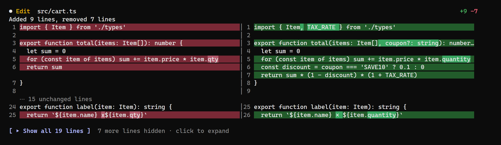

# Claude CLI Diff View

**Side-by-side, word-highlighted diffs for every edit Claude makes, right in your Claude Code terminal.**

Claude Code's terminal shows each edit as one long inline diff. Claude CLI Diff View turns it into a side-by-side view like the one in an editor: old code on the left, new code on the right, the changed words highlighted, and big edits folded so you never scroll past walls of code.



## Features

- 🪟 **Side by side in the chat.** Old on the left, new on the right, with line numbers on both sides, exactly where Claude Code draws its own diff. No extra panel, no window to manage.
- 🎯 **Word-level highlights.** Removed lines are red, added lines green, and the *exact words* that changed are marked in a stronger shade, so a one-word fix is visible at a glance.
- 📦 **Folded previews.** Each diff shows its first 12 lines with a **`[ ▸ Show all N lines ]`** button. Click to expand the full diff in place, **`[ ▾ Collapse ]`** to fold it back. ctrl+o (full transcript) always shows everything.
- 📐 **Fits any terminal.** Side by side from 120 columns; on narrower terminals the same view becomes one column of `-` / `+` rows.
- ⚡ **Zero setup.** Install once and it's on in every session. No commands, no settings.
- 🔒 **Read-only and free.** Built from the patch Claude Code already has for each edit: it reads no files, never changes or blocks an edit, makes no network or model calls, and costs no tokens.

## Install

At the prompt of a Claude Code terminal session:

```
/plugin install diff-view --marketplace GamingBlazer/claude-cli-diff-view
```

Answer `y` to add the marketplace, then choose the **user** scope to have it in every session. From a shell:

```
claude plugin install diff-view --marketplace GamingBlazer/claude-cli-diff-view
```

Update later with `claude plugin update diff-view@claude-cli-diff-view`, then `/reload-plugins`.

## How it works

Claude CLI Diff View is a Claude Code mod: one `ui.render` hook on the result row of the Edit and Write tools. It reads the `structuredPatch` that Claude Code stores with each edit, pairs removed and added lines, runs a word-level diff on each pair, and draws the rows in the theme's own diff colors. New files, errors, the desktop app and the VS Code extension keep Claude Code's own view.

## Requirements

Claude Code **2.1.319 or newer** in a terminal. Mods use Claude Code's function hooks, which are still early access, so a Claude Code update can change them; if the view stops appearing after an update, please open an issue.

## Development

```
claude plugin validate .
claude plugin test .
```

## License

MIT © GamingBlazer
